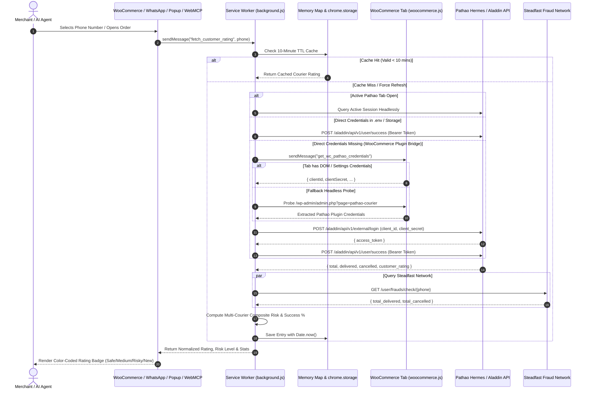
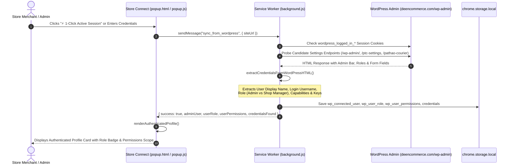
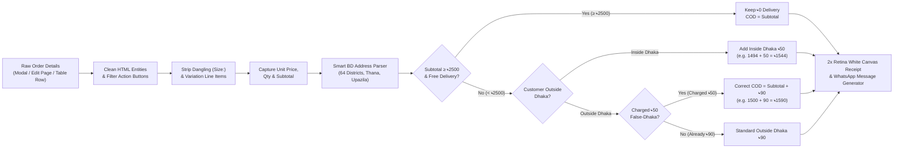
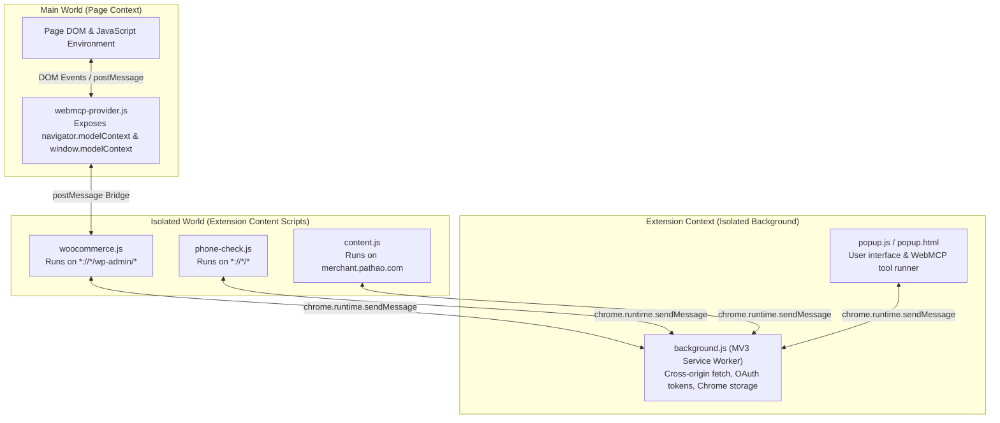

# 🏛️ Architecture & System Design (ARCHITECTURE.md)

This document details the high-level architecture, module interactions, data flows, security boundaries, and state management of the **DEEN Delivery Parser** Chrome Extension (Manifest V3) for **DEEN Commerce**.

---

## 1. High-Level Architecture Overview

```mermaid
flowchart TD
    subgraph UI Layer
        Popup["Popup Window (popup.html / popup.js)\n5 Tabs: Deliveries, Courier Check, Store Connect, WhatsApp, AI Tools"]
        Sidebar["Universal Sidebar Drawer (phone-check.js)"]
        FloatingPill["Floating Action Pill (phone-check.js)"]
        PathaoPill["Pathao Toolbar (content.js)"]
        WCOrderModal["Order Confirmation Modal (woocommerce.js)"]
        WCRatingCard["In-Popup Rating Card (woocommerce.js)"]
        WPProfile["WordPress Profile & Permissions Card"]
    end

    subgraph Agentic / WebMCP Layer
        WebMCP["WebMCP Provider (webmcp-provider.js)"]
        ModelCtx["navigator.modelContext / window.modelContext"]
        Agent["Autonomous AI Agent (Gemini Nano / Claude / Desktop Agent)"]
    end

    subgraph Business Logic & Parsing Engine
        ParserCore["Unified Parser Core (parser.js)"]
        AddressEngine["Smart BD Address & ISO District Engine (64 Districts)"]
        FeeEngine["Delivery Fee & False-Dhaka Correction Engine"]
        CanvasEngine["2x Retina Order Receipt Canvas Engine"]
        WAEngine["WhatsApp Quick Reply Generator"]
    end

    subgraph Chrome Extension Core (Manifest V3)
        ServiceWorker["Background Service Worker (background.js)"]
        Storage["chrome.storage.local (Persistent State & Caches)"]
        MemCache["In-Memory Map Cache (10-min TTL)"]
        WpSSO["WordPress SSO & Role/Permissions Manager"]
        PathaoBridge["WooCommerce Pathao Plugin Bridge & B2B OAuth"]
    end

    subgraph External Platforms & APIs
        WCDOM["WooCommerce Admin (deencommerce.com/wp-admin)"]
        PathaoDOM["Pathao Portal (merchant.pathao.com)"]
        HermesAPI["Pathao Hermes / Aladdin API (api-hermes.pathao.com)"]
        SteadfastAPI["Steadfast Fraud DB (steadfast.com.bd)"]
        OSMAPI["OpenStreetMap Nominatim Geocoding API"]
        WhatsAppAPI["WhatsApp Web / Deep Link (wa.me)"]
    end

    %% Agent Connections
    Agent <--> ModelCtx
    ModelCtx <--> WebMCP
    WebMCP --> ParserCore

    %% UI Connections
    WCDOM --> WCOrderModal & WCRatingCard
    PathaoDOM --> PathaoPill
    UniversalPages["Any Website (WhatsApp/FB/CRM)"] --> FloatingPill & Sidebar
    Popup --> WPProfile

    %% Logic Connections
    ParserCore --> AddressEngine & FeeEngine & WAEngine
    woocommerce.js --> ParserCore & CanvasEngine
    phone-check.js --> ParserCore
    content.js --> ParserCore

    %% Background & Service Worker Connections
    woocommerce.js <-->|chrome.runtime| ServiceWorker
    phone-check.js <-->|chrome.runtime| ServiceWorker
    Popup <-->|chrome.runtime| ServiceWorker
    WebMCP <-->|chrome.runtime| ServiceWorker
    ServiceWorker <--> Storage & MemCache & WpSSO & PathaoBridge

    %% External Connections
    ServiceWorker <--> HermesAPI & SteadfastAPI & OSMAPI
    WpSSO <--> WCDOM
    PathaoBridge <--> WCDOM & HermesAPI
    WAEngine --> WhatsAppAPI
```

---

## 2. Core Data Flow Pipelines

### A. Customer Delivery Risk & Rating Check Pipeline (with WooCommerce Pathao Bridge)



---

### B. WordPress Admin SSO, Role & Permissions Discovery Pipeline



---

### C. Order Details, Pricing & Address Correction Pipeline



---

## 3. Storage Architecture & State Management

| Storage Key | Engine | TTL | Description |
| :--- | :--- | :--- | :--- |
| `customer_rating_cache` | `chrome.storage.local` + `Map` | 10 Minutes | Cached courier ratings indexed by 11-digit phone number. Prevents redundant API calls. |
| `pathao_merchant_token` | `chrome.storage.local` | 30 Days | Active Pathao OAuth access token. |
| `pathao_token_expiry` | `chrome.storage.local` | 30 Days | Expiration epoch timestamp for Pathao access token. |
| `pathao_autofill_data` | `chrome.storage.local` | 5 Minutes | Transient payload for Pathao order creation form autofill. Cleaned on startup. |
| `pathao_batch_queue` | `chrome.storage.local` | Session | Queue state for bulk order dispatch progression. |
| `wp_connected_site` | `chrome.storage.local` | Permanent | Store URL currently synced (e.g. `https://deencommerce.com`). |
| `wp_connected_user` | `chrome.storage.local` | Permanent | Authenticated WordPress display name (e.g. `Sajid (Store Admin)`). |
| `wp_connected_login` | `chrome.storage.local` | Permanent | WordPress login username handle (e.g. `admin`). |
| `wp_user_role` | `chrome.storage.local` | Permanent | Authenticated role (`Administrator` or `Shop Manager`). |
| `wp_user_permissions` | `chrome.storage.local` | Permanent | Human-readable permission string (e.g. `Full Store & Settings Access (manage_options, manage_woocommerce)`). |
| `wp_auth_status` | `chrome.storage.local` | Permanent | Connection status (`connected`, `connected_no_creds`, `disconnected`). |
| `deen_quick_reply_config` | `chrome.storage.sync` / `local` | Permanent | Merchant bKash/Nagad accounts, store name, and shipping fee settings. |
| `phone_check_history` | `chrome.storage.local` | Permanent | Recent 30 customer phone searches in universal sidebar drawer. |

---

## 4. Multi-Context Scripting & Security Isolation

Google Chrome Manifest V3 enforces strict security boundaries:



1. **Isolated World (Default Content Scripts)**:
   - Scripts: `woocommerce.js`, `phone-check.js`, `content.js`.
   - Access to full DOM, but isolated from page JavaScript variables.
   - Communicates with Service Worker via `chrome.runtime.sendMessage`.
2. **Main World (`world: "MAIN"`)**:
   - Scripts: `webmcp-provider.js`.
   - Injected into page context so in-browser LLMs (Chrome Prompt API / Gemini Nano) can access `navigator.modelContext`.
   - Bridges tool invocations across window boundaries via secure `window.postMessage` listeners.
3. **Background Worker (MV3 Service Worker)**:
   - Script: `background.js`.
   - Lifecycled, non-persistent, reactive execution.
   - Holds the primary OAuth token management, cookie reads, and cross-origin fetch permissions for Pathao, Steadfast, and OpenStreetMap.
