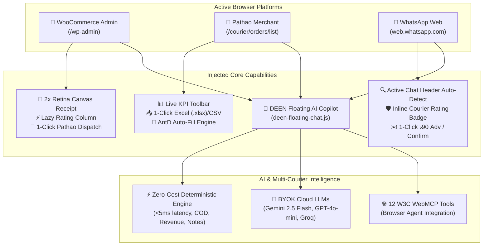

# 🚀 DEEN Delivery Parser — Comprehensive Technical Audit & System Inspection Report

**Target Extension Path:** `c:\Users\hp\Documents\chrome-extension-delivery-parser`  
**Manifest Version:** Google Chrome Extension Manifest V3 (MV3)  
**Primary Target Platforms:**
1. **Pathao Merchant Portal**: `https://merchant.pathao.com/courier/orders/list`
2. **WooCommerce Store Admin**: `https://deencommerce.com/wp-admin/admin.php?page=wc-orders&status=wc-processing`
3. **WhatsApp Web**: `https://web.whatsapp.com`

---

## 1. Executive Summary & Architecture Overview

The **DEEN Delivery Parser** extension is an enterprise-grade logistics copilot, fraud detection engine, and order management automation suite tailored for **DEEN Commerce** (D2C Apparel Brand, Bangladesh). It bridges three fragmented operational hubs into a single unified browser workflow:



---

## 2. In-Depth Technical Audit by Component

### A. WooCommerce Integration (`woocommerce.js`, `woocommerce.css`)
* **Target Scopes**: `*://*/wp-admin/*`, HPOS and legacy `shop_order` order tables.
* **Order Extraction**:
  - Automatically queries WooCommerce AJAX order preview endpoints and scrapes DOM tables.
  - Extracts Order ID, customer full name, 11-digit normalized phone, complete shipping address, line items with variations/sizes, unit prices, delivery fee, and COD totals.
* **Lazy-Loaded Customer Rating Column**:
  - Injects `Customer Rating` table header and cells.
  - Uses an `IntersectionObserver` with 350px root margin to fetch Pathao and Steadfast customer risk scores on scroll without blocking the main UI thread.
  - 24-hour persistent cache in `localStorage` prevents duplicate API queries.
* **2x Retina Visual Canvas Receipt Generator (`renderOrderReceiptCanvas`)**:
  - Renders a 640px wide 2x Retina digital receipt on an HTML5 `<canvas>`.
  - Pure white background with DEEN brand orange (`#ea580c`), brand logo from `icons/deen_logo.jpg`, and complete itemized billing.
  - 1-Click direct PNG copy to system clipboard using the modern `ClipboardItem` API for instant paste into WhatsApp Web.
* **WordPress Admin SSO & Credentials Bridge**:
  - Passively extracts client credentials, client secrets, and Steadfast API keys directly from WordPress settings forms, syncing them to background storage.

---

### B. Pathao Merchant Portal Automation (`content.js`, `content.css`)
* **Target Scopes**: `https://merchant.pathao.com/*`
* **In-Page Floating KPI Toolbar (`#deen-floating-widget`)**:
  - Displays live parsed metrics: *Total Parcels*, *Paid vs Unpaid*, *Total COD (৳)*, and *Net Revenue (৳)*.
* **1-Click Export Suite**:
  - `📥 Export to Excel (.xlsx)` via embedded SheetJS (`xlsx.mini.min.js`).
  - `📄 CSV`: RFC-4180 compliant export.
  - `📋 Copy Table`: TSV formatted clipboard export for Google Sheets.
* **React / Ant Design Consignment Auto-Fill Engine**:
  - Detects single or batch dispatch queues from WooCommerce or WhatsApp.
  - Auto-navigates from `/courier/orders/list` to `/courier/orders/create`.
  - Overcomes React 18 / Ant Design synthetic input binding by firing native value setters, simulated keyboard sequences, and blur events.
  - Smart Address Helper Pill (`#deen-address-helper-pill`) provides 1-click chips for district, upazila, and street segments.
* **Headless Token Interception**:
  - Hooks `fetch` and `XMLHttpRequest` to capture Pathao's bearer JWT token for headless rating verification.

---

### C. WhatsApp Web Active Chat Integration (`phone-check.js`, `phone-check.css`)
* **Target Scopes**: `https://web.whatsapp.com`
* **Active Chat Header Phone Auto-Detection (`extractWhatsAppActivePhone`)**:
  - Debounced `MutationObserver` (250ms) monitors active conversation switches.
  - Extracts phone numbers from unsaved titles (`+880 1715-485035`), custom status subtitles (`custom-status`), or recent message text.
* **Inline Header Rating Badge (`#deen-wa-header-rating-badge`)**:
  - Color-coded risk indicators:
    - `🛡️ 95% Delivery (19/20)` (Green - Safe Buyer)
    - `⚡ 75% Ratio (3/4)` (Amber - Moderate)
    - `⚠️ 45% Risk (5 Returns)` (Red - High Return Risk)
    - `⭐ New Buyer` (Blue - Clean Record)
* **Direct 1-Click Quick Actions**:
  - `💰 ৳90 Adv`: Automatically drafts and injects an advance delivery fee message with bKash/Nagad details into WhatsApp's message box (`footer div[contenteditable="true"]`).
  - `✅ Confirm`: Types order details summary into the active chat.
  - `📌`: Opens the slide-out courier intelligence drawer with search and history.

---

### D. In-Page Floating DEEN AI Assistant Chatbox (`deen-floating-chat.js`, `deen-assistant.js`)
* **Target Scopes**: WordPress Admin, Pathao Merchant Portal, WhatsApp Web.
* **Floating Launcher Trigger (`#deen-chat-trigger`)**:
  - Obsidian glass design with DEEN Orange glow, pulsing status dot, and dynamic item counter badge.
  - Collision-aware positioning: avoids Pathao's export dock and WhatsApp's message footer.
* **Context-Aware Telemetry Gathering**:
  - **WordPress Mode**: Reads DOM orders table, COD total, delivery charges, and customer notes. Prompt chips: `📊 Audit Orders`, `💰 COD Breakdown`, `⚠️ Risk Check`, `📍 Districts`.
  - **Pathao Mode**: Reads consignment records, uncollected COD, and payout statuses. Prompt chips: `💰 Uncollected COD`, `📦 Unpaid Parcels`, `🚚 In-Transit Status`, `📈 Net Revenue`.
  - **WhatsApp Mode**: Reads active contact name, phone, and recent customer messages. Prompt chips: `🛡️ Check Rating`, `💰 ৳90 Advance Fee`, `✅ Confirm Order`, `⚠️ Note & Risk Check` (interprets Banglish e.g. *"dekhe nibo"*).
* **Dual-Engine AI Intelligence**:
  - **Deterministic Engine**: Instant (<5ms) zero-latency calculations with zero API cost.
  - **BYOK Cloud LLM Engine**: Supports Google Gemini 2.5 Flash, OpenAI GPT-4o-mini, and Groq Cloud with encrypted client-side keys.

---

### E. W3C WebMCP Standard Registry (`webmcp-provider.js`)
Exposes **12 type-safe structured tools** to browser agents (`navigator.modelContext` / `window.modelContext`):
1. `check_customer_courier_rating`: Real-time multi-courier risk scoring.
2. `normalize_bd_address`: BD address cleaner across 64 districts & ~495 upazilas.
3. `build_full_address`: Formatted delivery label builder without duplicates.
4. `calculate_delivery_fee`: ৳50 inside Dhaka vs ৳90 outside Dhaka with false-Dhaka correction.
5. `generate_whatsapp_quick_reply`: Authentic Bengali message templates with deep links.
6. `get_woocommerce_active_orders`: Direct DOM active orders extractor.
7. `autofill_pathao_consignment`: Automated Pathao consignment creator.
8. `audit_and_auto_dispatch_orders`: Batch fraud risk auditor and safe order dispatcher.
9. `evaluate_multi_courier_routing`: Pathao vs Steadfast routing recommendation.
10. `process_ndr_tracking_alerts`: Non-Delivery Report (NDR) tracking scanner & rescue generator.
11. `sync_wordpress_admin_credentials`: Headless WordPress admin session probe.
12. `ask_deen_ai_assistant`: AI Copilot analytical query runner.

---

## 3. Automated Test Verification

All 13 test suites pass 100% across the repository:
```powershell
node run_all_suites.js
```
* `test_parser.js` — 100% 64 districts, address normalizer, fuzzy tokenization.
* `test_autofill_flow.js` — Manifest schema, Pathao table extractor, bulk queues.
* `test_popup_pathao_check.js` — Popup background messaging and timeout handlers.
* `test_live_pathao_rating_parsing.js` — Real Hermes API response handling.
* `test_universal_phone_e2e.js` — Selection, copy, floating pill, and sidebar drawer.
* `test_whatsapp_quick_reply.js` — 30 comprehensive tests for canvas receipts, COD rules.
* `test_webmcp_integration.js` — WebMCP registry schema conformance and execution.
* `test_full_fetch_improvements.js` — Notes extraction, in-flight deduplication, timeout protection.
* `test_wordpress_login_sync.js` — WordPress admin auto-connect, session sync, B2B external login.
* `test_icons_verification.js` — PNG/JPEG/SVG icon declarations across 16px, 32px, 48px, 128px.
* `test_deen_assistant.js` — Deterministic query engine, Banglish parser, BYOK clients.
* `test_whatsapp_active_chat.js` — WhatsApp active chat header phone detection, inline badge.
* `test_floating_chat.js` — In-page floating AI Copilot window across all 3 platforms.
