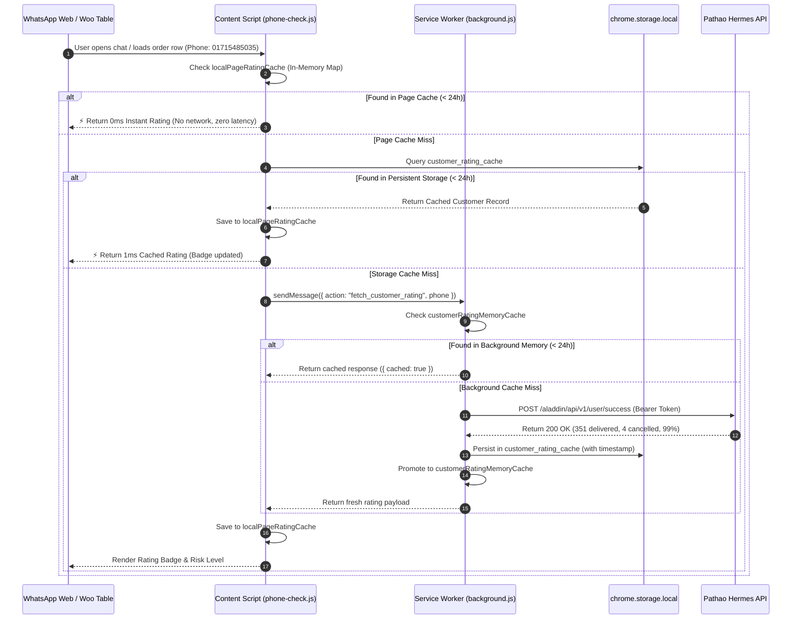
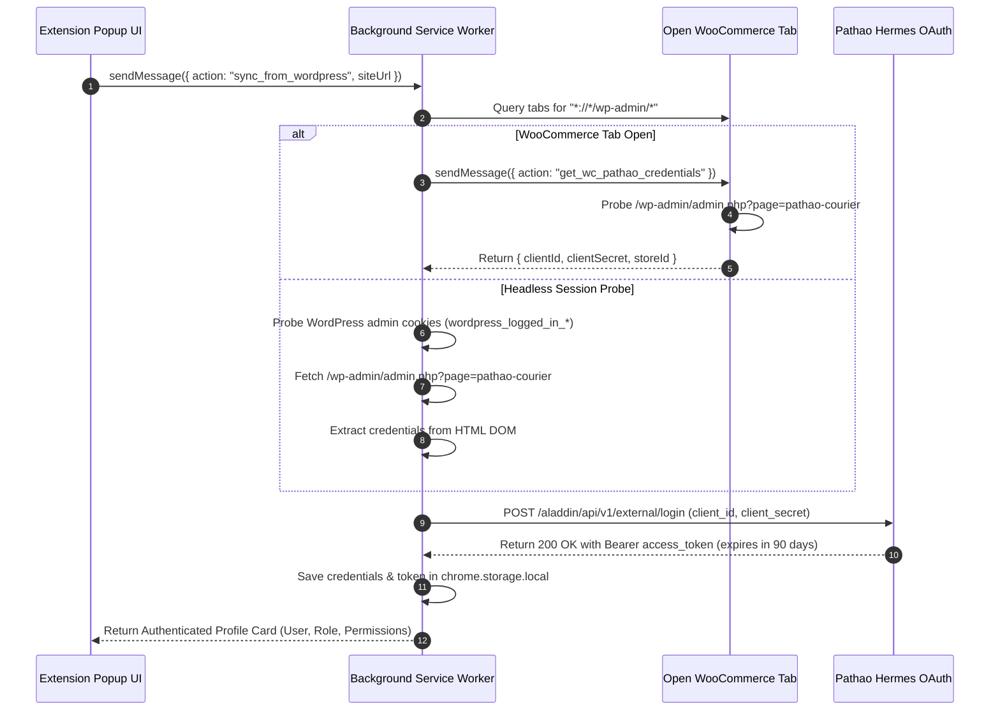

# 📐 System Design & Architecture Document (DESIGN.md)

## DEEN Delivery Parser — Autonomous Courier Logistics & Dispatch Engine

**Document Version:** 1.2.1  
**Architecture:** Event-Driven Chrome Extension Architecture (Manifest V3)

---

## 1. System Architecture Overview

```
+---------------------------------------------------------------------------------------+
|                                    Chrome Browser                                     |
|                                                                                       |
|   +-----------------------+   +------------------------+   +----------------------+   |
|   |  *://*/wp-admin/*     |   |  web.whatsapp.com      |   | merchant.pathao.com  |   |
|   |  (woocommerce.js)     |   |  (phone-check.js)      |   | (content.js)         |   |
|   |                       |   |                        |   |                      |   |
|   | - Table Order Details |   | - Active Chat Detection|   | - Floating Toolbar   |   |
|   | - 2x Retina Receipt   |   | - Header Rating Badge  |   | - Autofill Listener  |   |
|   | - Pathao Plugin Bridge|   | - Quick Reply Injector |   | - CSV/Excel Exporter |   |
|   | - NDR Row Decorator   |   | - Sidebar Customer Intel|  | - NDR Alert Scanner  |   |
|   +-----------+-----------+   +-----------+------------+   +----------+-----------+   |
|               |                           |                           |               |
|               +-------------------+       |       +-------------------+               |
|                                   |       |       |                                   |
|                                   v       v       v                                   |
|                       +---------------------------------------+                       |
|                       |  chrome.runtime.sendMessage / onMessage |                      |
|                       +-------------------+-------------------+                       |
|                                           |                                           |
|                                           v                                           |
|                       +---------------------------------------+                       |
|                       |   Background Service Worker           |                       |
|                       |   (background.js)                     |                       |
|                       |                                       |                       |
|                       | - Hermes B2B External Login           |                       |
|                       | - 24-Hour Tiered Local Cache          |                       |
|                       | - Steadfast Fraud Intelligence        |                       |
|                       | - WordPress SSO & Session Sync        |                       |
|                       | - Nominatim ISO3166 Geocoder          |                       |
|                       +-------------------+-------------------+                       |
|                                           |                                           |
+-------------------------------------------|-------------------------------------------+
                                            | HTTPS Fetch
        +-----------------------------------+-----------------------------------+
        |                                   |                                   |
+-------v-------+                   +-------v-------+                   +-------v-------+
| Pathao Hermes |                   | Steadfast BD  |                   | WordPress API |
| Aladdin APIs  |                   | Fraud Portal  |                   | & Woo Session |
+---------------+                   +---------------+                   +---------------+
```

---

## 2. Sequence Diagrams

### 2.1 Multi-Courier Customer Intelligence & 24h Local Cache Reuse



### 2.2 WordPress SSO & WooCommerce Pathao Plugin Bridge



---

## 3. Data Models & Schemas

### 3.1 Composite Customer Rating Object
```json
{
  "success": true,
  "phone": "01715485035",
  "ratingGrade": "Excellent Customer",
  "successRate": 99,
  "totalParcels": 355,
  "deliveredCount": 351,
  "cancelledCount": 4,
  "riskLevel": "low",
  "riskLabel": "Excellent Customer (99%)",
  "riskColor": "#10b981",
  "isNewCustomer": false,
  "cached": true,
  "cacheSource": "memory",
  "cachedAt": 1730591234567,
  "pathaoStats": {
    "total": 355,
    "delivered": 351,
    "cancelled": 4,
    "ratingGrade": "Excellent Customer"
  },
  "steadfastStats": {
    "total": 0,
    "delivered": 0,
    "cancelled": 0
  },
  "sources": {
    "pathao": { "checked": true, "ratingGrade": "Excellent Customer" },
    "steadfastNetwork": { "checked": false }
  }
}
```

### 3.2 Normalized Bangladesh Address Object
```json
{
  "original": "House 12, Road 4, Noyakandi Bazar, Titas,",
  "street": "House 12, Road 4, Noyakandi Bazar",
  "thana": "Titas",
  "zone": "Titas",
  "district": "Cumilla",
  "postcode": "",
  "isOutsideDhaka": true,
  "deliveryFee": 90,
  "fullAddress": "House 12, Road 4, Noyakandi Bazar, Titas, Cumilla"
}
```

---

## 4. Canvas 2D Rendering Engine Architecture

The 2x Retina Order Receipt canvas rendered by `renderOrderReceiptCanvas()`:
1. **High-DPI Coordinate Scaling:**
   - Canvas element CSS dimensions: $460\text{px} \times H\text{px}$.
   - Canvas bitmap dimensions: $(460 \times 2)\text{px} \times (H \times 2)\text{px}$.
   - Context scaling: `ctx.scale(2, 2)`.
2. **Visual Hierarchy:**
   - Background: Pure solid `#ffffff`.
   - Header Accent: Authentic DEEN Orange `#ea580c`.
   - Brand Logo: Rendered byte-for-byte from `DEEN_LOGO_BASE64` with aspect-ratio preservation.
   - Typography: Clean system fallback sans-serif stack (`system-ui, -apple-system, 'Segoe UI', Roboto`).
   - Line Items Table: Quantity, Title with Size, Unit Price, Line Total.
   - Barcode Simulation: Code 128 high-contrast vertical bars drawn directly via canvas rectangles based on Order ID characters.
3. **Clipboard Interoperability:**
   - Converted to PNG blob via `canvas.toBlob((blob) => ..., 'image/png')`.
   - Injected directly into the operating system clipboard using `navigator.clipboard.write([new ClipboardItem({ 'image/png': blob })])`.
