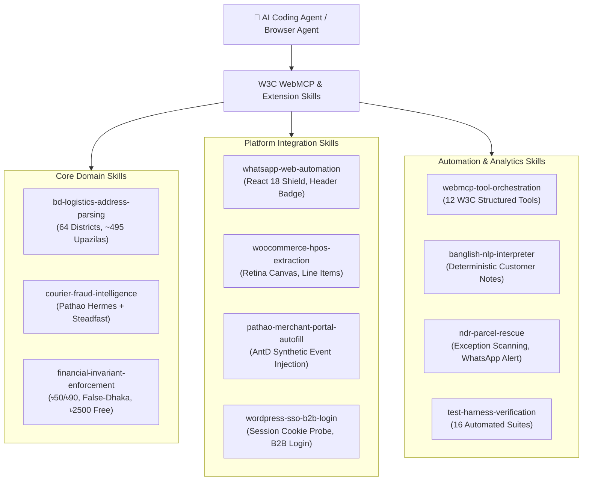

# 🧠 Agentic Skills & Capabilities Catalog (SKILLS.md)

## DEEN Delivery Parser — Autonomous Courier Logistics & Dispatch Engine

**Document Version:** 1.2.1  
**GitHub Repository:** [https://github.com/Sajid-ul-Islam/chrome-extension-delivery-parser](https://github.com/Sajid-ul-Islam/chrome-extension-delivery-parser)  
**Target Environment:** AI Agents (Antigravity, Gemini, Claude, Cursor), Forward Deployed Engineers (FDEs)  
**Standard:** Agentic Skill Specification & W3C WebMCP Protocol

---

## 1. Overview & Skill Architecture

This catalog defines the specialized operational and technical skills that AI Agents, autonomous subagents, and forward deployed engineers can invoke when inspecting, modifying, debugging, or operating the **DEEN Delivery Parser** codebase across any environment.

---

## 2. Agent Skill Registry

### Skill 1: `bd-logistics-address-parsing`
* **Module Reference:** [`parser.js`](https://github.com/Sajid-ul-Islam/chrome-extension-delivery-parser/blob/main/parser.js)
* **Description:** Parses, cleans, and normalizes messy Bangladeshi e-commerce delivery addresses without corrupting Bengali town names.
* **Capabilities:**
  - 100% coverage of all 64 Bangladesh districts (`BD_ISO_DISTRICTS`) and ~495 upazilas/thana zones (`OTHER_CITY_ZONES`).
  - **Reverse Zone Inference**: When an address mentions a thana/upazila without the district name (e.g. `Titas`), infers the parent district (`Cumilla`) instead of defaulting to Dhaka.
  - **Zero Bengali Text Corruption (Invariant 5)**: Word boundaries prevent corrupting Bengali town names like Benapole (`বেনাপোল`) into `Benaডাকঘর`.
  - Cleans accidental phone numbers, emails, and label noise (`House:`, `Road:`, `Flat:`) from street addresses.

---

### Skill 2: `courier-fraud-intelligence`
* **Module Reference:** [`background.js`](https://github.com/Sajid-ul-Islam/chrome-extension-delivery-parser/blob/main/background.js), [`phone-check.js`](https://github.com/Sajid-ul-Islam/chrome-extension-delivery-parser/blob/main/phone-check.js)
* **Description:** Headlessly queries Pathao Hermes API and Steadfast Courier fraud databases to assess customer return risks before dispatch.
* **Capabilities:**
  - Computes composite metrics: Delivery Success Rate (%), Completed Deliveries, Return Count, and Risk Grade (`Top Merchant` / `Good` / `Fair` / `Risky`).
  - **24-Hour 3-Tier Local Cache**:
    - Tier 1: In-page memory Map (`localPageRatingCache`) for **0ms** instant display.
    - Tier 2: Service worker memory Map (`customerRatingMemoryCache`) for **<1ms** tab sharing.
    - Tier 3: Persistent `chrome.storage.local` with FIFO capacity limit (500 items).
  - Graceful fallback: If Pathao fails or times out (7,000ms), automatically falls back to Steadfast.

---

### Skill 3: `financial-invariant-enforcement`
* **Module Reference:** [`parser.js`](https://github.com/Sajid-ul-Islam/chrome-extension-delivery-parser/blob/main/parser.js), [`woocommerce.js`](https://github.com/Sajid-ul-Islam/chrome-extension-delivery-parser/blob/main/woocommerce.js)
* **Description:** Enforces strict unit economics, courier delivery fee rules, and Free Shipping thresholds for DEEN Commerce.
* **Capabilities:**
  - Inside Dhaka standard delivery: **৳50**.
  - Outside Dhaka standard delivery: **৳90**.
  - **Free Shipping Threshold Policy (Invariant 7)**:
    - Subtotal $\ge ৳2500$: Free Shipping honored (`COD = Subtotal`, Delivery fee = ৳0).
    - Subtotal $< ৳2500$: Disqualified from free shipping. Standard fee (+৳50 inside / +৳90 outside) is automatically added to COD.
  - **False-Dhaka ৳50 Correction**: If an outside-Dhaka customer selected inside-Dhaka delivery (paying only ৳50), fee is automatically corrected to **৳90** (`Subtotal + ৳90`).
  - **0 Shipping / COD Equal to Subtotal Addition**: Automatically adds delivery fee when WooCommerce had 0 shipping on orders $< ৳2500$.

---

### Skill 4: `whatsapp-web-automation`
* **Module Reference:** [`phone-check.js`](https://github.com/Sajid-ul-Islam/chrome-extension-delivery-parser/blob/main/phone-check.js)
* **Description:** Injects real-time courier ratings and 1-click message drafting directly inside WhatsApp Web (`web.whatsapp.com`).
* **Capabilities:**
  - **Active Chat Header Phone Detection**: Debounced `MutationObserver` (250ms) extracts phone numbers from unsaved titles or custom statuses.
  - **React 18 Reconciliation Safeguard**: Prevents `insertBefore` NotFoundError crashes via DOM Node Reuse Pattern and defensive wrappers on `Node.prototype.insertBefore` and `removeChild`.
  - **1-Click Quick Replies**: Auto-drafts Bengali messages for ৳90 advance delivery charge, order confirmation, and high-risk alerts into WhatsApp's message box (`div[contenteditable="true"]`).
  - Instant `wa.me` deep link generator with international `880` formatting.

---

### Skill 5: `woocommerce-hpos-extraction`
* **Module Reference:** [`woocommerce.js`](https://github.com/Sajid-ul-Islam/chrome-extension-delivery-parser/blob/main/woocommerce.js)
* **Description:** Extracts orders, variations, unit prices, and billing details from WooCommerce HPOS and legacy tables.
* **Capabilities:**
  - Debounced extraction across table rows, preview modals, and AJAX edit endpoints.
  - **2x Retina Visual Canvas Receipt Generator (Invariant 6)**: Renders 640px wide high-resolution receipt on pure white background (`#ffffff`) with brand DEEN Orange (`#ea580c`), authentic logo bytes (`DEEN_LOGO_BASE64`), itemized sizes (e.g. `Size: 36`), and 1-click clipboard copy (`ClipboardItem`).
  - Lazy-loads customer ratings in order table cells using `IntersectionObserver` (350px root margin).

---

### Skill 6: `pathao-merchant-portal-autofill`
* **Module Reference:** [`content.js`](https://github.com/Sajid-ul-Islam/chrome-extension-delivery-parser/blob/main/content.js)
* **Description:** Scans parcel tables and automates consignment booking forms on `merchant.pathao.com`.
* **Capabilities:**
  - In-page floating KPI toolbar: Live calculations for Total Parcels, Paid/Unpaid ratio, Total COD (৳), and Net Revenue (৳).
  - 1-Click Excel export (`.xlsx`) via embedded SheetJS, CSV export with UTF-8 BOM, and TSV clipboard copy.
  - **React 18 / Ant Design Synthetic Input Autofill**: Overcomes synthetic input binding using native property descriptors, simulated keyboard events, and blur triggers.
  - Floating Address Helper Pill (`#deen-address-helper-pill`) for 1-click street and upazila insertion.

---

### Skill 7: `wordpress-sso-b2b-login`
* **Module Reference:** [`background.js`](https://github.com/Sajid-ul-Islam/chrome-extension-delivery-parser/blob/main/background.js), [`popup.js`](https://github.com/Sajid-ul-Islam/chrome-extension-delivery-parser/blob/main/popup.js)
* **Description:** Manages zero-manual configuration WordPress SSO and courier API key synchronization.
* **Capabilities:**
  - 1-Click active session probe from `deencommerce.com/wp-admin` cookies.
  - Direct `wp-login.php` authentication fallback.
  - Categorizes user roles into `Administrator` (`manage_options, manage_woocommerce`) and `Shop Manager` (`manage_woocommerce`).
  - **WooCommerce Pathao Plugin Bridge (Invariant 10)**: Probes `/wp-admin/admin.php?page=pathao-courier` and issues access tokens via Pathao **B2B External Login** (`/aladdin/api/v1/external/login`) with `client_id` + `client_secret`.

---

### Skill 8: `webmcp-tool-orchestration`
* **Module Reference:** [`webmcp-provider.js`](https://github.com/Sajid-ul-Islam/chrome-extension-delivery-parser/blob/main/webmcp-provider.js)
* **Description:** Exposes and executes the 12 W3C WebMCP structured tools for autonomous browser agents.
* **Capabilities:**
  - Registers tools on `navigator.modelContext` / `window.modelContext`.
  - Validates argument schemas and semantic hints (`readOnlyHint`, `consequentialHint`).
  - Tools include: `check_customer_courier_rating`, `normalize_bd_address`, `build_full_address`, `calculate_delivery_fee`, `generate_whatsapp_quick_reply`, `get_woocommerce_active_orders`, `autofill_pathao_consignment`, `evaluate_optimal_courier`, `calculate_multifactor_risk`, `process_ndr_tracking_event`, `query_deen_assistant`, `sync_wordpress_admin_credentials`.

---

### Skill 9: `banglish-nlp-interpreter`
* **Module Reference:** [`deen-assistant.js`](https://github.com/Sajid-ul-Islam/chrome-extension-delivery-parser/blob/main/deen-assistant.js)
* **Description:** Client-side zero-latency deterministic parser for Banglish and Bengali customer checkout notes.
* **Capabilities:**
  - Analyzes notes for delivery constraints: *"shukrobar pathaben"* (Friday delivery), *"office time e diben"* (business hours), *"phone diye ashben"* (call before delivery).
  - Risk indicators: *"dekhe nibo"* (open-box check), *"chole gele nibo na"* (strict deadline).
  - Runs in **<5ms** with zero external API calls or token costs.

---

### Skill 10: `ndr-parcel-rescue`
* **Module Reference:** [`courier-adapters.js`](https://github.com/Sajid-ul-Islam/chrome-extension-delivery-parser/blob/main/courier-adapters.js)
* **Description:** Real-time Non-Delivery Report (NDR) tracking event listener and automated customer rescue engine.
* **Capabilities:**
  - Detects failed delivery attempt keywords (*"Customer Unreachable"*, *"Rider Could Not Contact"*, *"Address Incomplete"*).
  - Decorates failed rows with red alert pills and injects 1-click WhatsApp rescue triggers.
  - Opens prefilled `wa.me` customer rescue messages to reschedule delivery before parcel is marked for return.

---

### Skill 11: `test-harness-verification`
* **Module Reference:** [`run_all_suites.js`](https://github.com/Sajid-ul-Islam/chrome-extension-delivery-parser/blob/main/run_all_suites.js)
* **Description:** Runs and maintains the master 16-suite automated test harness.
* **Capabilities:**
  - Executes all 16 test suites via `node run_all_suites.js` ensuring 100% pass rate.
  - Enforces Invariant 1 (module export preservation) across all modules.
  - Verifies financial assertions against real WooCommerce orders (#17819, #18264, #18276, #18304, #19029, #19046).
  - Ensures clean test exit codes without blocking timers (`unref()`).

---

## 3. How Autonomous Agents Should Invoke Skills

When performing development or maintenance tasks on any machine:
1. **Identify Relevant Skill**: Match your task to one of the 11 specialized skills above.
2. **Review Invariant Rules**: Check [`AGENTS.md`](https://github.com/Sajid-ul-Islam/chrome-extension-delivery-parser/blob/main/AGENTS.md) for related non-negotiable rules.
3. **Inspect Implementation Module**: Navigate directly to the module listed under *Module Reference* on GitHub.
4. **Execute Verification Suite**: Run the corresponding unit test or `node run_all_suites.js` to ensure zero regressions.
