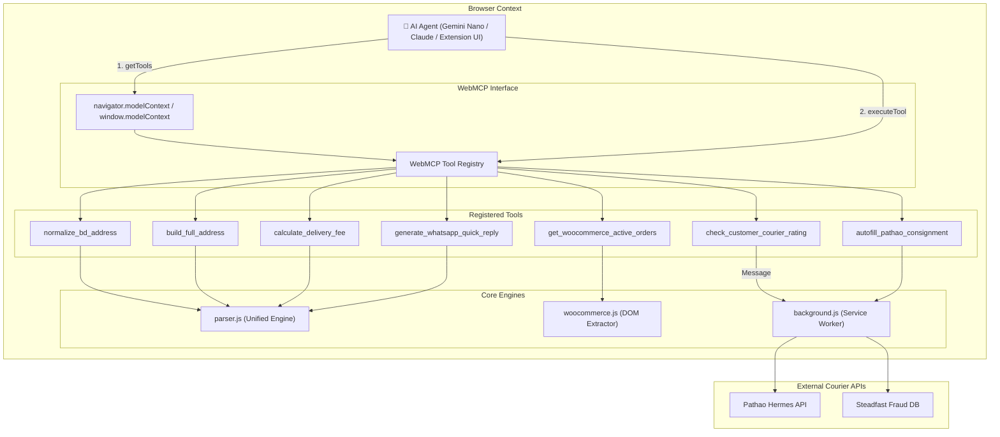

# 🤖 W3C WebMCP (Web Model Context Protocol) Specification & Integration Guide

## 1. Overview & Vision

**WebMCP (Web Model Context Protocol)** is an emerging browser-native standard incubated within the **W3C Web Machine Learning Community Group** (with active contributions from Google Chrome and Microsoft). 
* Specification Draft: [https://webmachinelearning.github.io/webmcp/](https://webmachinelearning.github.io/webmcp/)
* GitHub Repository: [https://github.com/webmachinelearning/webmcp](https://github.com/webmachinelearning/webmcp)

### The Problem WebMCP Solves
Traditionally, autonomous AI agents attempting to interact with web applications (e.g. WooCommerce stores, courier portals, CRMs) rely on **fragile visual actuation**:
- Taking screenshots or dumping massive DOM accessibility trees into LLM context windows.
- Guessing coordinates of buttons, form fields, and dropdowns.
- Simulating mouse clicks and keyboard typing.

This approach is **slow, token-expensive, privacy-invasive, and prone to breaking** whenever UI layout, CSS class names, or DOM hierarchies change.

### The WebMCP Inverted Paradigm
WebMCP allows web applications and Chrome extensions to **directly register structured, type-safe JavaScript tools** into the browsing environment (`navigator.modelContext` / `document.modelContext`). AI agents (such as Chrome's built-in Gemini Nano / Prompt API, Claude in Chrome, or desktop autonomous agents) can discover these tools and call them with structured JSON arguments, receiving clean JSON responses with zero scraping.

---

## 2. Architecture in DEEN Delivery Parser

In this extension, [`webmcp-provider.js`](file:///d:/Repo/chrome-extension-delivery-parser/webmcp-provider.js) serves as a **WebMCP Bridge & Adapter** across:
1. **WooCommerce Store Admin** (`deencommerce.com/wp-admin`)
2. **Pathao Merchant Portal** (`merchant.pathao.com`)
3. **Universal Web Pages** (WhatsApp Web, Facebook, CRMs, etc.)



---

## 3. Registered WebMCP Tools Specification

The extension registers **7 core tools** conforming to the WebMCP schema and semantic hint conventions:

### Tool 1: `check_customer_courier_rating`
* **Purpose**: Performs real-time headless risk assessment across Pathao and Steadfast courier networks using the customer's phone number.
* **Semantic Hints**: `readOnlyHint: true`, `idempotentHint: true`, `consequentialHint: false`
* **Input Schema**:
  ```json
  {
    "type": "object",
    "properties": {
      "phone": {
        "type": "string",
        "description": "11-digit Bangladeshi mobile number (e.g. '01712345678' or '+8801...')"
      },
      "forceRefresh": {
        "type": "boolean",
        "description": "Bypass 10-minute cache and force a live courier check"
      }
    },
    "required": ["phone"]
  }
  ```
* **Sample Output**:
  ```json
  {
    "success": true,
    "phone": "01715485035",
    "ratingGrade": "Top Merchant",
    "successRate": 95,
    "totalParcels": 20,
    "deliveredCount": 19,
    "cancelledCount": 1,
    "riskLevel": "low",
    "riskLabel": "Safe Buyer (95% Success)",
    "riskColor": "#10b981",
    "isNewCustomer": false,
    "pathaoStats": {
      "total": 15,
      "delivered": 14,
      "cancelled": 1,
      "name": "Verified Customer"
    },
    "steadfastStats": {
      "total": 5,
      "delivered": 5,
      "cancelled": 0
    }
  }
  ```

---

### Tool 2: `normalize_bd_address`
* **Purpose**: Standardizes messy customer checkout addresses, removes accidental noise (Home/Office labels, emails, phone numbers), resolves ISO 3166-2:BD district codes, and prevents phonetic distortions (e.g. preserving Benapole without corrupting it into Benaডাকঘর).
* **Semantic Hints**: `readOnlyHint: true`, `idempotentHint: true`
* **Input Schema**:
  ```json
  {
    "type": "object",
    "properties": {
      "rawAddress": {
        "type": "string",
        "description": "Raw messy customer shipping address"
      }
    },
    "required": ["rawAddress"]
  }
  ```
* **Sample Output**:
  ```json
  {
    "normalizedStreetAddress": "Benapole City, Thana: Sharsha, District: Jashore Benapole",
    "fullAddress": "Benapole City, Thana: Sharsha, District: Jashore Benapole",
    "district": "Jashore",
    "zone": "Sharsha",
    "cityType": "Outside Dhaka",
    "postcode": "",
    "isOutsideDhaka": true
  }
  ```

---

### Tool 3: `build_full_address`
* **Purpose**: Constructs the finalized modified full address suitable for courier labels by appending resolved District, Zone, and Postcode without duplicating existing words or aliases in either English or Bengali.
* **Semantic Hints**: `readOnlyHint: true`, `idempotentHint: true`
* **Input Schema**:
  ```json
  {
    "type": "object",
    "properties": {
      "rawAddress": {
        "type": "string",
        "description": "Customer checkout address"
      }
    },
    "required": ["rawAddress"]
  }
  ```
* **Sample Output**:
  ```json
  {
    "fullAddress": "House 12, Road 4, Mirpur 10, Dhaka - 1216"
  }
  ```

---

### Tool 4: `calculate_delivery_fee`
* **Purpose**: Computes verified shipping charges (৳50 inside Dhaka vs ৳90 outside Dhaka) based on district/zone aliases, with automated correction for orders where customers outside Dhaka falsely selected inside-Dhaka delivery.
* **Semantic Hints**: `readOnlyHint: true`, `idempotentHint: true`
* **Input Schema**:
  ```json
  {
    "type": "object",
    "properties": {
      "address": {
        "type": "string",
        "description": "Delivery address, city, or district name"
      },
      "isOutsideDhaka": {
        "type": "boolean",
        "description": "Explicit outside Dhaka flag"
      },
      "feeOverride": {
        "type": "number",
        "description": "Optional custom fee override"
      }
    }
  }
  ```
* **Sample Output**:
  ```json
  {
    "deliveryFee": 90,
    "isOutsideDhaka": true,
    "currency": "BDT (৳)"
  }
  ```

---

### Tool 5: `generate_whatsapp_quick_reply`
* **Purpose**: Generates authentic, courteous Bengali WhatsApp customer messages and verified `wa.me` deep links for advance delivery fees, order confirmations, return risk alerts, and tracking notices.
* **Semantic Hints**: `readOnlyHint: true`, `idempotentHint: true`
* **Input Schema**:
  ```json
  {
    "type": "object",
    "properties": {
      "templateKey": {
        "type": "string",
        "enum": ["advance_fee", "confirm_order", "high_risk_notice", "tracking_info", "order_details_confirm"],
        "description": "Template key"
      },
      "phone": { "type": "string", "description": "Recipient phone number" },
      "orderId": { "type": "string", "description": "WooCommerce Order ID (e.g. '18304')" },
      "customerName": { "type": "string", "description": "Customer full name" },
      "codAmount": { "type": "number", "description": "Total COD amount in BDT" },
      "address": { "type": "string", "description": "Delivery shipping address" },
      "isOutsideDhaka": { "type": "boolean", "description": "Whether recipient is outside Dhaka" },
      "items": { "type": "array", "description": "List of line items" }
    },
    "required": ["templateKey", "phone"]
  }
  ```
* **Sample Output**:
  ```json
  {
    "templateKey": "advance_fee",
    "phone": "01715485035",
    "messageText": "আসসালামু আলাইকুম Kazi Morshed! ... কুরিয়ার ডেলিভারি চার্জ ৳90 অগ্রিম প্রদান করতে হবে ...",
    "deepLink": "https://wa.me/8801715485035?text=%E0%A6%86%E0%A6%B8%E0%A6%B8%E0%A6%BE%E0%A6%B2%E0%A6%BE%E0%A6%AE%E0%A7%81..."
  }
  ```

---

### Tool 6: `get_woocommerce_active_orders`
* **Purpose**: Extracts active orders from the WooCommerce Admin orders list, including order IDs, customer names, normalized phones, clean addresses, line item titles with sizes, unit prices, delivery fee, and COD totals.
* **Semantic Hints**: `readOnlyHint: true`
* **Input Schema**:
  ```json
  {
    "type": "object",
    "properties": {
      "limit": {
        "type": "number",
        "description": "Maximum number of orders to extract (default: 25)"
      }
    }
  }
  ```

---

### Tool 7: `autofill_pathao_consignment`
* **Purpose**: Prepares and dispatches complete order information into the Pathao Merchant Portal booking form (`/courier/orders/create`).
* **Semantic Hints**: `consequentialHint: true` (Flagged as consequential so AI agents prompt user confirmation before mutating dispatch queues).
* **Input Schema**:
  ```json
  {
    "type": "object",
    "properties": {
      "phone": { "type": "string", "description": "Customer 11-digit BD mobile number" },
      "name": { "type": "string", "description": "Customer recipient name" },
      "address": { "type": "string", "description": "Normalized delivery shipping address" },
      "cod": { "type": "number", "description": "Cash on delivery amount to collect in BDT" },
      "orderId": { "type": "string", "description": "Merchant order ID reference (e.g. '18304')" },
      "autoSwitch": { "type": "boolean", "description": "Whether to automatically navigate or focus the Pathao tab" }
    },
    "required": ["phone", "address"]
  }
  ```

---

## 4. How Autonomous AI Agents Consume WebMCP Tools

Any agent running in Chrome or connected via CDP/Puppeteer/extension can interact with WebMCP using standard JavaScript:

### Step 1: Tool Discovery
```javascript
// Discover all tools registered on the page
const tools = await (navigator.modelContext || window.modelContext).getTools();
console.log(tools.map(t => `${t.name}: ${t.description}`));
```

### Step 2: Agent Tool Execution
```javascript
// Example: Agent checking a customer's fraud rating
const result = await (navigator.modelContext || window.modelContext).executeTool(
  "check_customer_courier_rating",
  { phone: "01715485035" }
);

if (result.riskLevel === "high") {
  // Agent executes WhatsApp quick reply generator for high risk
  const waReply = await window.modelContext.executeTool("generate_whatsapp_quick_reply", {
    templateKey: "high_risk_notice",
    phone: result.phone,
    orderId: "18304"
  });
  console.log("Send notice:", waReply.deepLink);
}
```

---

## 5. Security & Permission Boundaries

1. **Origin Scoping**:
   - WebMCP tools inherit the active tab's session and security context.
   - External websites cannot invoke courier API endpoints without valid credentials or user-authenticated cookies.
2. **Consequential Action Gates (`consequentialHint`)**:
   - Read-only tools (`readOnlyHint: true`) can run autonomously.
   - Consequential tools (`consequentialHint: true`, e.g. `autofill_pathao_consignment`) signal to agentic runtimes that explicit merchant confirmation should be requested before parcel creation.
3. **No Unfiltered Cookie Scraping**:
   - The background service worker never scans cookies globally; it targets only `pathao.com` authentication tokens strictly for live rating verification.
