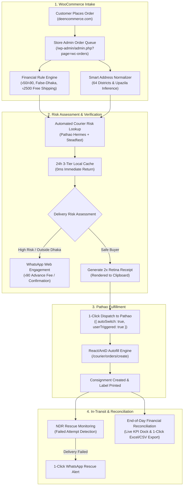
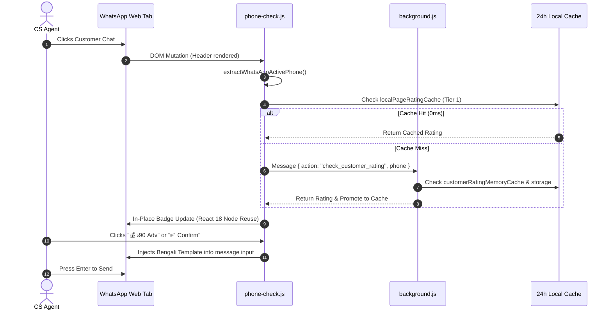
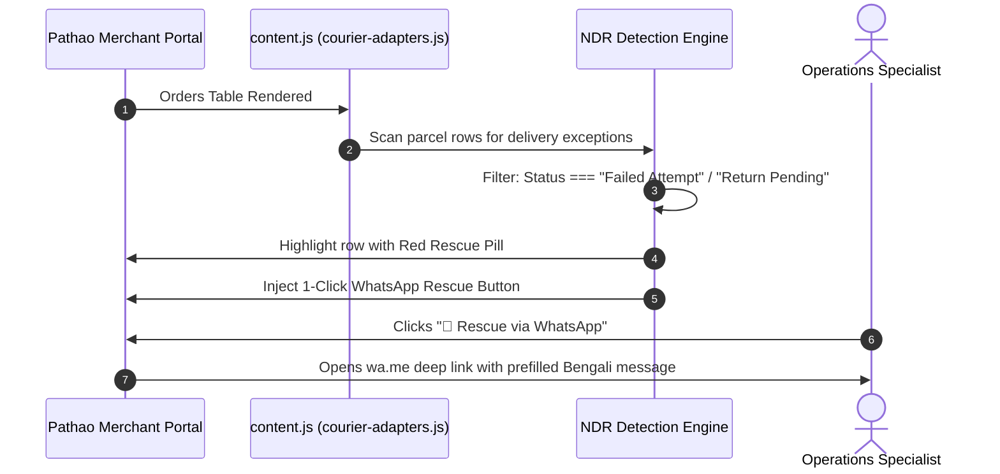
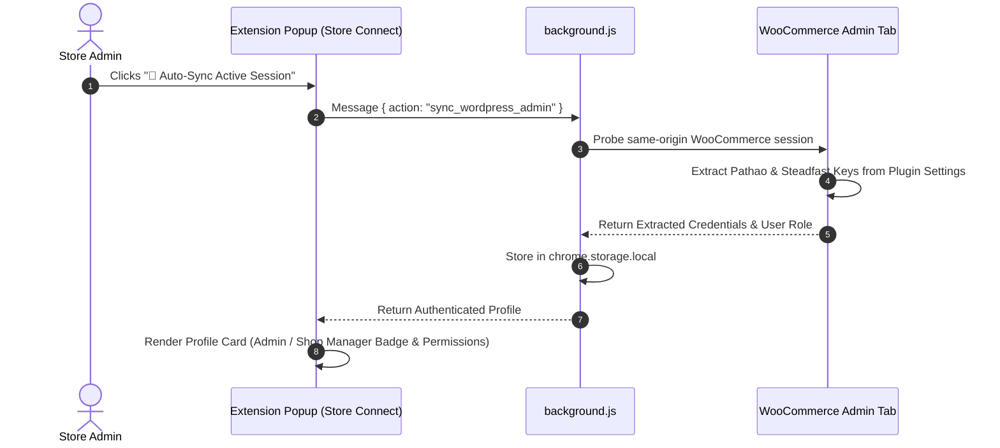

# 🔄 Operational & Engineering Workflows (WORKFLOW.md)

## DEEN Delivery Parser — Autonomous Courier Logistics & Dispatch Engine

**Document Version:** 1.2.1  
**Target Environment:** Google Chrome Extension Manifest V3 (MV3)  
**Target Platforms:** WooCommerce Admin, Pathao Merchant Portal, WhatsApp Web  
**Primary Users:** Store Managers, Fulfillment Staff, CS Agents, Forward Deployed Engineers (FDEs)

---

## 1. End-to-End Logistics Lifecycle

The **DEEN Delivery Parser** orchestrates an integrated, automated workflow connecting the three central hubs of **DEEN Commerce** operations:



---

## 2. Core Operational Workflows

### Workflow 1: WooCommerce Order Verification & Address Normalization

* **Actor:** Store Manager / Fulfillment Specialist  
* **Platform:** `https://deencommerce.com/wp-admin/admin.php?page=wc-orders`

#### Step-by-Step Procedure:
1. **Open WooCommerce Processing Orders**:
   - Navigate to **WooCommerce > Orders** (status: `Processing`).
2. **Review Injected Customer Rating Column**:
   - The extension automatically injects a `Customer Rating` column.
   - An `IntersectionObserver` triggers lazy risk evaluation for visible rows:
     - 🟢 **Top Merchant / Safe Buyer ($\ge 85\%$)**: Green badge, safe for instant dispatch.
     - 🟡 **Moderate / Medium Risk ($60\% - 84\%$)**: Amber badge, requires confirmation.
     - 🔴 **High Return Risk ($< 60\%$)**: Red badge, strictly requires ৳90 advance delivery fee via bKash/Nagad before packing.
     - 🔵 **New Buyer**: Blue badge, no return history recorded.
3. **Inspect Financial Invariants**:
   - **Subtotal $\ge ৳2500$**: Legitimate Free Shipping orders preserve **৳0 delivery fee** (`COD = Subtotal`).
   - **Subtotal $< ৳2500$**: Disqualified from free shipping even if WooCommerce displayed 0 shipping. Standard delivery fee is automatically added (**+৳50 inside Dhaka**, **+৳90 outside Dhaka**).
   - **False-Dhaka Correction**: If a customer selected inside-Dhaka delivery (৳50) but specified an outside-Dhaka district (e.g. Bogura, Sylhet, Cumilla), the fee is automatically corrected to **৳90** (`Subtotal + ৳90`).
4. **Smart Address Auto-Resolution**:
   - The parser inspects the billing and shipping address blocks.
   - If a thana/upazila is mentioned without the district (e.g. `Titas`), reverse zone inference maps it directly to `Cumilla` without defaulting to Dhaka.
   - Word boundaries prevent name corruption (e.g. `বেনাপোল` is never corrupted into `Benaডাকঘর`).
5. **Open Order Preview Modal**:
   - Click the preview icon (eye icon) or row action button to view the itemized breakdown.

---

### Workflow 2: WhatsApp Customer Confirmation & Advance Fee Collection

* **Actor:** Customer Service (CS) Agent  
* **Platform:** `https://web.whatsapp.com` or WooCommerce Order Modal



#### Step-by-Step Procedure:
1. **Open Active WhatsApp Chat**:
   - Open a chat with the customer on `web.whatsapp.com` or click the extension's `💬 WhatsApp` 1-click `wa.me` deep link.
2. **Instant Header Rating Verification**:
   - The header automatically displays the recipient's courier rating badge with colored risk pill (High/Medium/Low/New).
   - React 18 reconciliation safeguard prevents DOM detach crashes (`insertBefore` protection).
3. **1-Click Message Dispatch**:
   - Click **`💰 ৳90 Adv`**: Automatically drafts an authentic Bengali message requesting advance courier charge via bKash/Nagad:
     > *"আসসালামু আলাইকুম [Name]! DEEN Commerce থেকে আপনার অর্ডারটি নিশ্চিত করতে অনুগ্রহ করে কুরিয়ার চার্জ ৳৯০ অগ্রিম বিকাশ করুন..."*
   - Click **`✅ Confirm`**: Drafts order confirmation summary with item titles, size, subtotal, and COD total.
4. **Copy & Paste 2x Retina Receipt Canvas**:
   - In WooCommerce, click **`📸 Copy Receipt`**.
   - Switch to WhatsApp Web and press `Ctrl + V`.
   - The pixel-perfect 2x Retina receipt (white `#ffffff` background with `#ea580c` headers and authentic brand logo) pastes instantly as a high-DPI image.

---

### Workflow 3: Pathao Consignment Auto-Dispatch

* **Actor:** Warehouse Fulfillment Packer  
* **Platform:** `https://merchant.pathao.com/courier/orders/create`

#### Step-by-Step Procedure:
1. **Single Order Dispatch**:
   - In WooCommerce, click **`🚚 Pathao Dispatch`**.
   - The extension dispatches with flags `{ autoSwitch: true, userTriggered: true }`.
   - Browser automatically switches to the Pathao tab and navigates to `/courier/orders/create`.
2. **React 18 & Ant Design Synthetic Field Autofill**:
   - The content script (`content.js`) listens for the autofill trigger.
   - Overcomes React 18 input tracking by executing native property descriptors:
     - Customer Name
     - Normalized 11-digit Phone (`01XXXXXXXXX`)
     - Resolved City / District
     - Resolved Zone / Upazila
     - Cleaned Street Address (free of duplicate labels)
     - Cash on Delivery (COD) Amount
     - Order Reference / Notes (Order # and item summary)
3. **Smart Address Helper Pill**:
   - If manual adjustments are needed, click chips on the floating `#deen-address-helper-pill` to instantly insert street, upazila, or postal code.
4. **Submit Booking**:
   - Review consignee details and click **Save Order**.

---

### Workflow 4: Non-Delivery Report (NDR) & Parcel Rescue

* **Actor:** Logistics Operations Specialist  
* **Platform:** `https://merchant.pathao.com/courier/orders/list`



#### Step-by-Step Procedure:
1. **Open Pathao Orders List**:
   - Navigate to `/courier/orders/list` and filter by active deliveries.
2. **Automated NDR Detection**:
   - `courier-adapters.js` actively scans tracking events for delivery exception keywords (*"Customer Unreachable"*, *"Rider Could Not Contact"*, *"Address Incomplete"*).
   - Delivered parcels are strictly excluded.
3. **Visual Highlight & Rescue Trigger**:
   - High-risk / failed rows are decorated with an amber/red border and rescue trigger badge.
4. **1-Click WhatsApp Rescue Notification**:
   - Click **`🚨 Rescue via WhatsApp`** on the affected row.
   - An instant `wa.me` deep link opens with prefilled text asking the customer for alternative instructions or confirming their availability for tomorrow's re-attempt.

---

### Workflow 5: End-of-Day Financial Reconciliation & Batch Export

* **Actor:** Finance Manager / Store Administrator  
* **Platform:** `https://merchant.pathao.com/courier/orders/list`

#### Step-by-Step Procedure:
1. **Open Floating KPI Toolbar (`#deen-floating-widget`)**:
   - On the Pathao portal, the floating widget automatically computes live metrics:
     - **Total Consignments Scanned**
     - **Paid vs Unpaid Delivery Count**
     - **Total COD Collection (৳)**
     - **Net Payout Payable (৳)**
2. **Export Reconciliation Data**:
   - Click **`📥 Export to Excel (.xlsx)`**: Uses standalone embedded SheetJS (`xlsx.mini.min.js`) with formatted currency columns for offline accounting.
   - Click **`📄 Export CSV`**: Exports RFC-4180 compliant CSV with UTF-8 BOM encoding for Bengali name fidelity.
   - Click **`📋 Copy TSV`**: Formats the scanned dataset into clipboard TSV format, ready for direct paste into Google Sheets.

---

### Workflow 6: WordPress SSO & Zero-Config Credential Sync

* **Actor:** Store Administrator / CS Lead  
* **Platform:** Extension Popup (`🌐 Store Connect`)



#### Step-by-Step Procedure:
1. **Open Extension Popup**:
   - Click the DEEN Delivery Parser icon in the Chrome toolbar.
2. **Navigate to `🌐 Store Connect` Tab**:
   - If already logged into `deencommerce.com/wp-admin` in any tab, click **`⚡ Auto-Sync Active Session`**.
   - Zero manual API key copy-pasting is required.
3. **Verify Authenticated Profile Card**:
   - Confirms user identity (e.g. `Sajid (Store Admin) (@admin)`).
   - Confirms store domain (`deencommerce.com`).
   - Confirms assigned role badge (`🛡️ Administrator` vs `🛒 Shop Manager`).
   - Lists capability permissions (`Full Store & Settings Access: manage_options, manage_woocommerce`).
4. **Pathao WooCommerce Plugin Fallback**:
   - If direct API secrets are missing in `env.js`, the background worker automatically bridges to `/wp-admin/admin.php?page=pathao-courier` and issues tokens via Pathao **B2B External Login** (`/aladdin/api/v1/external/login`).

---

### Workflow 7: AI Copilot & WebMCP Browser Agent Interaction

* **Actor:** Autonomous AI Agent / Store Manager  
* **Platform:** In-Page Floating Chatbox (`deen-floating-chat.js`) or WebMCP API

#### Step-by-Step Procedure:
1. **Trigger Floating Copilot**:
   - Click the draggable circular brand launcher in the bottom corner of WooCommerce, Pathao, or WhatsApp Web.
2. **Context-Aware Dynamic Prompt Chips**:
   - **On WooCommerce**: Click `📊 Audit Orders`, `💰 COD Breakdown`, `⚠️ Risk Check`, `📍 Districts`.
   - **On Pathao**: Click `💰 Uncollected COD`, `📦 Unpaid Parcels`, `🚚 In-Transit Status`, `📈 Net Revenue`.
   - **On WhatsApp**: Click `🛡️ Check Rating`, `💰 ৳90 Advance Fee`, `✅ Confirm Order`, `⚠️ Note & Risk Check`.
3. **Zero-Cost Deterministic Engine**:
   - Calculations for COD totals, parcel counts, and Banglish customer note interpretations (e.g. *"shukrobar pathaben"*, *"dekhe nibo"*) run in **<5ms** with zero external API calls.
4. **Autonomous Agent Execution via W3C WebMCP**:
   - Browser agents call tools directly via `window.modelContext`:
     ```javascript
     const registry = navigator.modelContext || window.modelContext;
     const risk = await registry.executeTool("check_customer_courier_rating", { phone: "017XXXXXXXX" });
     const address = await registry.executeTool("normalize_bd_address", { rawAddress: "..." });
     ```

---

## 3. Engineering & CI/CD Workflow

### Daily Developer Quality Assurance Routine

Before committing code or preparing a release, Forward Deployed Engineers must execute the master verification suite:

```powershell
# 1. Run Complete 16-Suite Test Harness
node run_all_suites.js

# 2. Individual Subsystem Verification (if modifying specific modules)
node test_whatsapp_quick_reply.js      # Order Receipt Canvas, line items, pricing rules
node test_local_rating_cache_reuse.js  # 24h 3-tier local cache verification
node test_whatsapp_active_chat.js      # React 18 insertBefore & WhatsApp DOM reuse
node test_wordpress_login_sync.js      # WordPress SSO & B2B login bridge
node test_webmcp_integration.js        # 12 WebMCP tool schemas & execution
```

### Staging & Git Workflow
```powershell
# Check repository status
git status

# Stage updated files
git add <file>

# Verify invariants compliance
# Ensure Invariants 1-11 in AGENTS.md are 100% satisfied
```

---

## 4. Operational Invariant Quick Reference

| Invariant | Threshold / Rule | Enforcement Action |
| :--- | :--- | :--- |
| **Inside Dhaka Delivery** | Standard Delivery Fee: **৳50** | COD = Subtotal + ৳50 (for orders < ৳2500) |
| **Outside Dhaka Delivery** | Standard Delivery Fee: **৳90** | COD = Subtotal + ৳90 (for orders < ৳2500) |
| **Free Shipping Threshold** | Product Subtotal $\ge$ **৳2,500** | Free Delivery preserved (৳0 shipping charged) |
| **Disqualified Free Shipping** | Product Subtotal $<$ **৳2,500** | Auto-add ৳50 inside Dhaka / ৳90 outside Dhaka |
| **False-Dhaka Selection** | Outside district with ৳50 fee | Auto-corrected to ৳90 outside Dhaka |
| **Cache Lifetime** | **24 Hours** (`86,400,000 ms`) | 0ms local in-page hit; FIFO eviction at 500 items |
| **Observer Debounce** | Minimum **200ms** | Eliminates CPU thrashing during dynamic DOM updates |

